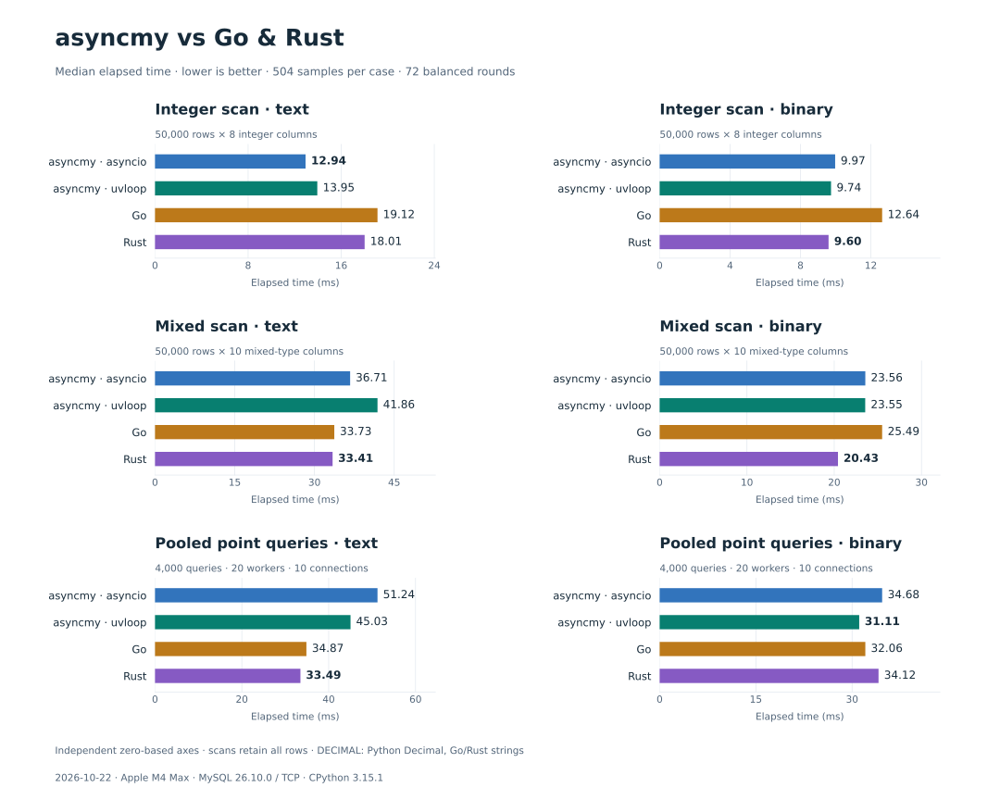
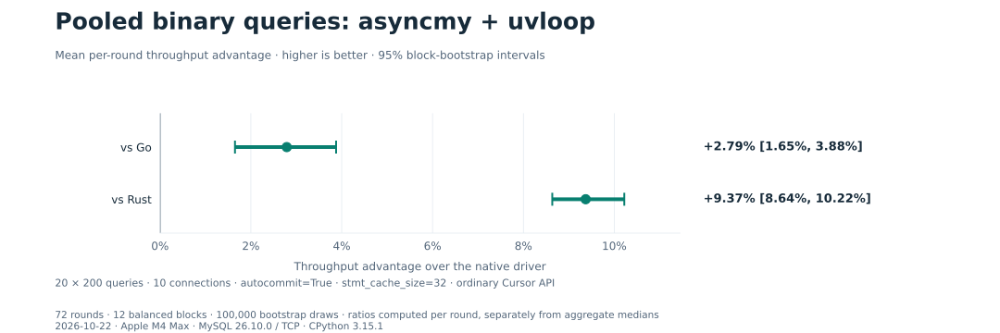
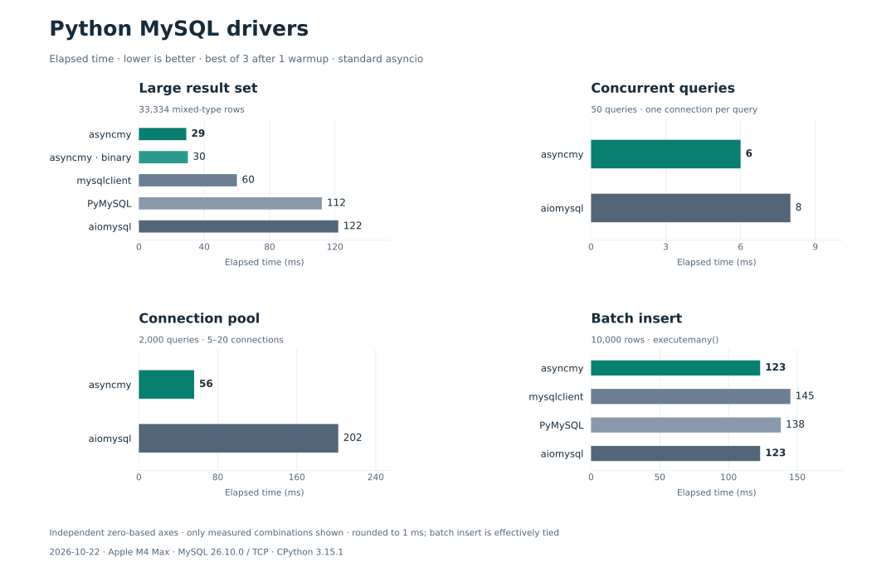

# asyncmy Benchmark Suite

This directory contains two benchmark suites:

| Suite | Drivers | Workloads | Reported statistic |
| --- | --- | --- | --- |
| [Cross-language](./crosslang/README.md) | asyncmy (asyncio / uvloop), Go `go-sql-driver/mysql`, Rust `mysql_async` | 50k-row integer/mixed scans; 20×200 pooled point queries; text and binary separately | Median of 504 samples per case across 72 balanced rounds |
| [Python drivers](#python-driver-suite) | asyncmy, mysqlclient, PyMySQL, aiomysql | Large result sets, concurrent connections, connection pools, batch inserts | One warmup, then best of three runs |

Both suites were measured on 2026-10-22 with the current toolchain. The
[cross-language results](#current-results) retain all 504 samples per case;
the [Python-driver snapshot](#python-driver-results) records the console-reported
best-of-three timings from one suite invocation. Keep these sampling methods
and workloads separate when comparing results.

## Current results

Measured on **2026-10-22** against the existing local MySQL instance over TCP.

| Component | Version / setting |
| --- | --- |
| Hardware / OS | Apple M4 Max / macOS 27.0.1 arm64 |
| MySQL | 26.10.0 |
| CPython / Cython | 3.15.1 / 3.3.0 |
| uvloop | 0.23.0 |
| Go / go-sql-driver/mysql | 1.27.3 / 1.10.1 |
| Rust / mysql_async / Tokio | 1.99.1 / 0.37.1 / 1.54.1 |
| Connection | TCP `127.0.0.1:3306`, autocommit enabled |
| Point queries | 10 prewarmed connections, 20 workers × 200 queries |

Times are **milliseconds**, lower is better. Each value is the median of all
**504 timed samples** per case, with no samples discarded.



| Scenario | asyncmy asyncio | asyncmy uvloop | Go | Rust |
| --- | ---: | ---: | ---: | ---: |
| 50k rows × 8 integer columns, text | 12.94 | 13.95 | 19.12 | 18.01 |
| 50k rows × 8 integer columns, binary | 9.97 | 9.74 | 12.64 | 9.60 |
| 50k rows × 10 mixed columns, text | 36.71 | 41.86 | 33.73 | 33.41 |
| 50k rows × 10 mixed columns, binary | 23.56 | 23.55 | 25.49 | 20.43 |
| Pooled 20×200 point queries, text | 51.24 | 45.03 | 34.87 | 33.49 |
| Pooled 20×200 point queries, binary | 34.68 | 31.11 | 32.06 | 34.12 |

For pooled binary point queries, ordinary asyncmy Cursor calls with uvloop,
`stmt_cache_size=32` and `autocommit=True` lead Go and Rust in this configuration.
Mean per-round throughput advantage is **2.79% over Go** (95% CI
**1.65–3.88%**) and **9.37% over Rust** (95% CI **8.64–10.22%**). Individual
rounds overlap; the intervals describe the average advantage, calculated by
resampling balanced six-round blocks.



Both native drivers lead on text point queries, and Rust leads on mixed scans.
In mixed scans, Python constructs `Decimal` values while Go/Rust retain DECIMAL
strings, so materialization differs. These results describe the measured workloads and
configuration, rather than a general ranking for every application.

[Full methodology, reproduction commands and API example](./crosslang/README.md)
include the client-order schedule, confidence-interval calculation and
transaction/pool settings. [results.json](./crosslang/results.json) contains all
raw samples, environment details, source hashes, validation results and
separately labeled earlier measurements.

## Methodology

The suites use different sampling rules and schemas. Compare drivers within
the same suite and protocol case.

The cross-language suite runs clients sequentially through all six client-order
permutations, repeated twelve times. Each round has one warmup and seven timed
samples per case (72 × 7 = 504). Python uses one event-loop thread, Rust uses a
current-thread Tokio runtime, and Go sets `GOMAXPROCS(1)`; helper threads can
still exist. All scan rows are fetched and retained. Binary scans explicitly
prepare once; binary point queries reuse each connection's prepared-statement
cache. Every point query includes pool acquisition, query, fetch and release.

The Python-driver suite uses [`best_result()`](./__init__.py): one warmup followed
by three measured runs, reporting the fastest. It uses standard asyncio and
`autocommit=True`. Its large-result test also includes an asyncmy binary case;
the other Python-driver workloads use the text protocol.

## Python driver suite

### Python driver results

Measured on 2026-10-22, Apple M4 Max, macOS 27.0.1 arm64, MySQL 26.10.0 over
TCP, CPython 3.15.1, Cython 3.3.0 and standard asyncio. Drivers: asyncmy 0.2.17
(working tree), mysqlclient 2.3.0, PyMySQL 1.2.3 and aiomysql 0.3.2.

Times are milliseconds rounded to the nearest millisecond from the runner's
console output. Each entry is the fastest of three runs after one warmup.



| Workload | asyncmy | mysqlclient | PyMySQL | aiomysql |
| --- | ---: | ---: | ---: | ---: |
| Large result set, 33,334 mixed-type rows | **29** | 60 | 112 | 122 |
| 50 concurrent queries, one connection each | **6** | — | — | 8 |
| 2,000 pooled queries, 5–20 connections | **56** | — | — | 202 |
| Batch insert, 10,000 rows | **123** | 145 | 138 | **123** |

The asyncmy column uses text protocol; the separate asyncmy binary large-result
case took 30 ms with `stmt_cache_size=16`. A dash marks an unmeasured combination.
The read and pool workloads favor asyncmy; batch insertion is effectively tied
with aiomysql in this run. This single best-of-three snapshot does not provide
the repeated-round confidence intervals of the cross-language suite.

[Recorded Python-driver results](./python-results.json) contain the reported
timings, throughput, versions, settings and source hashes. Individual sample
timings were not captured by this runner invocation.

### Workloads

The setup creates 100,000 rows in `test.benchmark_data`.

| Module | Workload | Drivers |
| --- | --- | --- |
| [`large_resultset.py`](./large_resultset.py) | Fetch all columns where `is_active=1`, about 33,334 rows in the initial dataset | asyncmy text, asyncmy binary (`stmt_cache_size=16`), mysqlclient, PyMySQL, aiomysql |
| [`concurrent.py`](./concurrent.py) | 50 concurrent SELECTs, each opening and closing its own connection | asyncmy, aiomysql |
| [`pool.py`](./pool.py) | 2,000 concurrent SELECTs through a pool of 5–20 connections | asyncmy, aiomysql |
| [`batch_insert.py`](./batch_insert.py) | Insert 10,000 rows with `executemany()` | asyncmy, mysqlclient, PyMySQL, aiomysql |

The schema includes integers, VARCHAR/TEXT, DATETIME and DECIMAL columns, with
indexes on `user_id` and `created_at`. See [`setup.py`](./setup.py) for the exact
schema and generated values, and [`__init__.py`](./__init__.py) for defaults.
These workloads use `test.benchmark_data`; the cross-language suite uses the
separate `test.bench` table.

### Run all four workloads

Use a local MySQL server and run from the repository root. To match the Python
build used for the recorded cross-language results:

```bash
uv sync --all-groups --frozen --python 3.15.1

export MYSQL_HOST=127.0.0.1
export MYSQL_PORT=3306
export MYSQL_USER=root
export MYSQL_PASS=123456

.venv/bin/python -m benchmark.run_all
```

The suite reads these environment variables, with defaults `localhost`, `3306`,
`root`, and `123456`. The database name is fixed to `test`. It requires permission
to create the database and create/drop tables in it.

`run_all` recreates `test.benchmark_data`, populates 100,000 rows, runs the four
workloads, prints their rankings, then drops that table in cleanup. The existing
`test.bench` data used for cross-language tests is retained.

### Run individual workloads

Individual modules require data setup first and leave cleanup to the caller:

```bash
.venv/bin/python -m benchmark.setup
.venv/bin/python -m benchmark.large_resultset
.venv/bin/python -m benchmark.concurrent
.venv/bin/python -m benchmark.pool
.venv/bin/python -m benchmark.batch_insert
.venv/bin/python -c 'from benchmark.setup import cleanup_database; cleanup_database()'
```

The batch-insert workload adds active rows; recreate the dataset with
`benchmark.setup` before repeating read workloads if you need their initial row
counts. Keep other database activity, builds and tests out of measured runs.
Record the environment and protocol configuration alongside results.

### Configuration

Defaults in [`__init__.py`](./__init__.py):

```python
ROW_COUNT = 100000
BATCH_SIZE = 10000
CONCURRENT_COUNT = 50
WARMUP_RUNS = 1
MEASURED_RUNS = 3  # Fastest measured run is reported.
```

The Python-suite pool settings are in [`pool.py`](./pool.py): minimum 5,
maximum 20 connections and 2,000 queries. These differ from the cross-language
suite's fixed ten-connection pool and 4,000 point queries.

## Regenerate the charts

The SVG charts are generated from [python-results.json](./python-results.json)
and [crosslang/results.json](./crosslang/results.json). They use independent
zero-based time axes for each workload; the throughput chart uses the recorded
per-round advantage and its block-bootstrap confidence interval. Tables remain
alongside the charts for exact values and accessible text.

From the repository root:

```bash
uv run scripts/plot_benchmarks.py
uv run scripts/plot_benchmarks.py --check
```

The script pins Matplotlib in an isolated uv environment. It reads the recorded
data without running database workloads or changing the driver's dependencies.
To export PNGs, add `--format png --output-dir /tmp/asyncmy-charts`.

## Contributing

Add a module with a `run_benchmark()` function returning `(driver, elapsed)`
pairs sorted by elapsed time, then call it from [`run_all.py`](./run_all.py).
Use `best_result()` for the Python suite. For cross-language changes, keep the
queries, transport, transaction settings, result retention and protocol mode
aligned across clients. Retain raw samples and record source hashes when
publishing new results.

## License

[Apache-2.0](../LICENSE)
