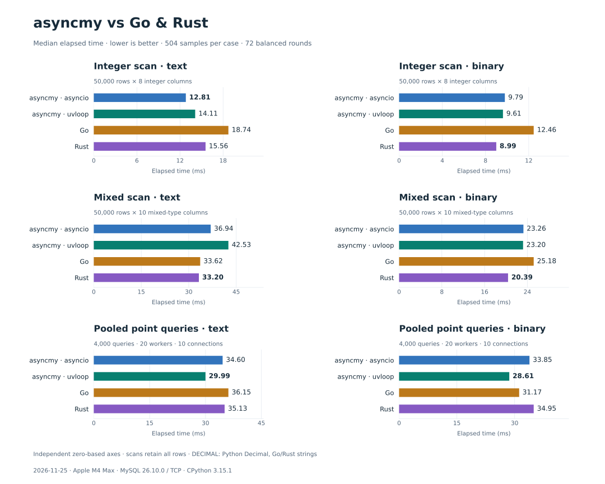
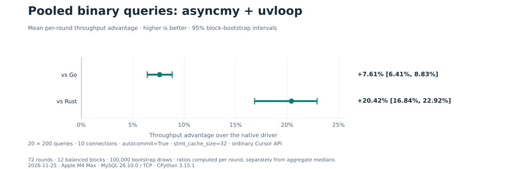

# Cross-language benchmark: asyncmy vs Go/Rust MySQL drivers

Local MySQL driver workloads using the same table, queries, TCP transport,
autocommit mode, and connection limit. Text and cached prepared-statement
(binary) paths are measured separately.

For the separate mysqlclient/PyMySQL/aiomysql suite, see the
[benchmark overview](../README.md#python-driver-suite).

## Results

Measured on 2026-11-25: Apple M4 Max, macOS 27.2.1 arm64, MySQL 26.10.0,
CPython 3.15.1, Cython 3.3.0, uvloop 0.23.0, Go 1.27.3 with
go-sql-driver/mysql 1.10.1, Rust 1.99.1 with mysql_async 0.37.1 / Tokio 1.54.1.
The existing 50,000-row benchmark table was preserved.

Times are **milliseconds**, the **median of 504 samples** per case: 72 rounds
with all six client-order permutations repeated twelve times. Each round has
one warmup and seven timed runs per case. Clients run sequentially. Python uses
one event-loop thread, Rust uses Tokio's current-thread runtime, and Go sets
`GOMAXPROCS(1)`; runtimes may also use helper threads. MySQL runs normally.



| Scenario | asyncmy asyncio | asyncmy uvloop | Go | Rust |
| --- | ---: | ---: | ---: | ---: |
| 50k rows × 8 integer columns, text | 12.81 | 14.11 | 18.74 | 15.56 |
| 50k rows × 8 integer columns, binary | 9.79 | 9.61 | 12.46 | 8.99 |
| 50k rows × 10 mixed columns, text | 36.94 | 42.53 | 33.62 | 33.20 |
| 50k rows × 10 mixed columns, binary | 23.26 | 23.20 | 25.18 | 20.39 |
| Pooled 20×200 point queries, text | 34.60 | 29.99 | 36.15 | 35.13 |
| Pooled 20×200 point queries, binary | 33.85 | 28.61 | 31.17 | 34.95 |

The ordinary pooled Cursor path with uvloop leads both native drivers on both
text and binary point queries. Mean per-round throughput advantage and 95%
confidence intervals (12 balanced six-round blocks, 100,000 bootstrap draws,
seed 20261125):

- **Pooled text point queries (`stmt_cache_size=0`)**: **+18.90% [17.01%,
  20.27%] over Go** (72/72 round wins) and **+15.71% [12.61%, 18.02%] over
  Rust** (69/72 round wins).
- **Pooled binary point queries (`stmt_cache_size=32`)**: **+7.61% [6.41%,
  8.83%] over Go** (68/72 round wins) and **+20.42% [16.84%, 22.92%] over
  Rust** (72/72 round wins).



Every one of the 12 balanced six-round blocks favors asyncmy + uvloop against
both Go and Rust on both text and binary point queries. Rust leads on binary
integer scans and mixed scans.

[Raw samples, source hashes, environment and validation](results.json) retain
all 504 samples per case in round order, without discarding samples. Each round
records its client order, medians, and the offset of its seven samples in the
aggregate arrays. Earlier toolchains and optimization stages are separate.
Compared with the earlier 2026-10-22 build on the same MySQL 26.10.0 server and
toolchain, uvloop text point queries dropped from 45.03 ms to 29.99 ms (-33.4%),
asyncio text point queries dropped from 51.24 ms to 34.60 ms (-32.5%), and
uvloop binary point queries improved further from 31.11 ms to 28.61 ms (-8.0%).

The current build keeps healthy pool checkout synchronous, coalesces waiter
notifications, uses typed internal connection/pool/protocol state, and parses
complete cached text and binary results directly into `Cursor` / `DictCursor`
rows after verifying the column-definition bytes. Text row parsing decodes
integers, floats, and temporal values inline in C from pre-compiled column
specs; `DictCursor` streams rows directly into presized dicts; `executemany()`
serializes positional `INSERT`/`REPLACE` batches in C. A specialized lazy pool
checkout avoids coroutine allocation on healthy acquisitions; CPython 3.10+
uses the public `am_send` result protocol.

On plain POSIX sockets with an empty transport write queue, small `COM_QUERY`
packets and single built-in numeric/NULL prepared parameters are packed and
sent from a small stack buffer. TLS, queued writes, unsupported parameters, and
replaced command/write hooks retain the transport path; a short or blocked send
returns its unsent bytes to that path in order. Class and instance hooks remain
effective. Release hooks cannot suppress exceptions raised inside the pool
context.

Partial responses, changed metadata, warnings, extra result sets and cursor
subclasses retain their general paths. Large parameters are encoded once;
streaming cursors retain unbuffered operation. Public Connection, Pool and
PreparedStatement classes remain mutable and subclassable. Remaining Python
modules were kept as Python; optimization targets the hot paths and allocations.

Validated against local MySQL: CPython 3.15.1 passed 310 tests (2
free-threading-only tests skipped). Ruff, mypy (57 files) and stubtest (34
modules) passed.

## Measurement details

- TCP `127.0.0.1:3306`, autocommit enabled, ten prewarmed pooled connections.
  Each point query acquires and releases a connection: 20 workers × 200 queries.
- Rust's `prefer_socket=false` enforces TCP. `reset_connection=false` matches
  the other pools' session reuse behavior and preserves prepared statements.
- Text point queries interpolate the integer parameter on the client. Binary
  point queries reuse server-side prepared statements on each connection.
  Go uses `db.Prepare`, Rust uses its statement cache, and asyncmy uses
  `stmt_cache_size=32` through the normal Cursor API.
- Binary scans use an explicitly prepared statement (`conn.prepare()` in
  asyncmy); text scans use a regular Cursor. Statement preparation is outside
  scan timing, and point-query caches are populated by the warmup.
- Scans retain all 50,000 typed rows in every language. Integer scans return
  `a,b,a,b,a,b,a,b`; mixed scans return all ten columns of `test.bench`.
  Python/Rust use row tuples, while Go stores structs/arrays through `database/sql`.
- All three construct temporal values, including a duration for TIME. DECIMAL
  remains a string in Go/Rust; Python constructs a `Decimal`, so mixed-type
  materialization still differs. Allocation and garbage collection also differ.
- Scan timing includes fetching and constructing all rows; checksum validation
  follows timing. Python collects cyclic garbage before each measured run.
- The old Python script used autocommit off. InnoDB SELECTs then left an open
  transaction, causing pool release to discard connections and later queries to
  reconnect. The old Go point test also prepared and closed a statement per
  query; its scan did not retain rows. Those earlier numbers used different
  settings and should not be compared with this table.

## Reproduce

Use a local `test` database with the test credentials in the scripts
(root / 123456). Run commands from the repository root. Rust's toolchain file
selects 1.99.1; install Go 1.27.3 and MySQL 26.10.0 to match this run.
These scripts use fixed connection settings in their source; the Python-driver
suite's `MYSQL_*` environment variables do not configure them. Set all three
clients to the same server when changing the connection settings.

```bash
uv sync --all-groups --frozen --python 3.15.1

# Populate an empty test.bench, then benchmark both Python event loops.
# Existing data is not dropped.
PYTHONPATH="$PWD" .venv/bin/python benchmark/crosslang/python_bench.py --setup

# Later runs can omit --setup; --loop asyncio / uvloop selects one loop.
PYTHONPATH="$PWD" .venv/bin/python benchmark/crosslang/python_bench.py

(cd benchmark/crosslang/go && go run .)
(cd benchmark/crosslang/rust && cargo run --release --locked)
```

Run the three clients sequentially in each of these orders:
Go/Python/Rust, Rust/Python/Go, Python/Go/Rust, Rust/Go/Python,
Go/Rust/Python, Python/Rust/Go. Repeat this complete balanced group twelve
times (72 rounds) to reproduce the measurement. Aggregate all 504 samples for
each runtime/case and take their median. Keep every sample.

For confidence intervals, compute each round's point-query throughput
advantage as `native_median_ms / asyncmy_uvloop_median_ms - 1`. Average each
consecutive six-round group's advantages. Draw twelve such group means with
replacement 100,000 times (Python `random.Random(20261125).choices`), taking the
mean of each draw. Reset the seed for each comparison. Sort the draw means
and use elements 2,499 and 97,499 (zero-based) as the percentile interval.
The exact block means and interval bounds are in `results.json`.

Each client emits one JSON object per case with its seven samples. The warmup
is excluded. Data setup accepts an empty table or an existing 50,000-row
benchmark table and refuses a partially populated table.

To use the measured point-query configuration in an application:

```python
import asyncmy
import uvloop


async def main():
    pool = await asyncmy.create_pool(
        host="127.0.0.1", port=3306, user="root", password="123456", db="test",
        minsize=10, maxsize=10, autocommit=True, stmt_cache_size=32,
    )
    try:
        async with pool.acquire() as conn:
            async with conn.cursor() as cur:
                await cur.execute("SELECT a FROM test.bench WHERE id=%s", (1,))
                assert await cur.fetchone() == (0,)
    finally:
        pool.close()
        await pool.wait_closed()


uvloop.run(main())
```

Both settings are explicit opt-ins: asyncmy defaults to `autocommit=False`
and `stmt_cache_size=0`. Choose autocommit according to application transaction
semantics. Binary-protocol FLOAT results expose the stored binary value rather
than the text protocol's rounded decimal representation.
